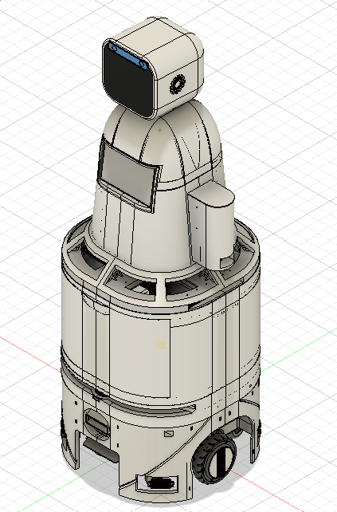
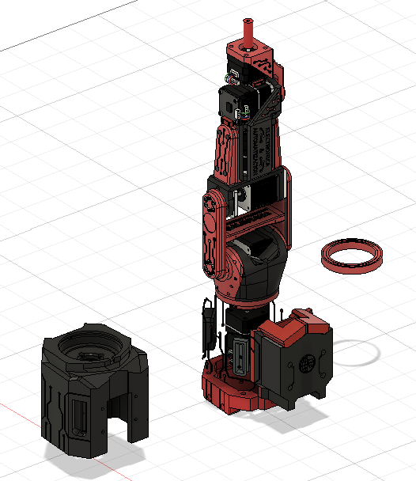

<h1 align="center">Hola, soy Juan Guncay · Hi, I'm Juan Guncay 👋</h1>
<h3 align="center">Ingeniero Electrónico · Electronics Engineer Robótica · Robotics · ROS 2</h3>

  
  
  

---

## 🤖 Sobre mí · About me

**🇪🇸 Español**

Soy **ingeniero electrónico** apasionado por la **robótica**. Me enfoco en el diseño, la simulación y el control de robots móviles con **ROS 2** y **Gazebo**: desde el modelado CAD y la descripción URDF hasta la navegación autónoma, el SLAM y el control embebido de actuadores.

- 🔭 Actualmente trabajo en **UVIX**, un robot asistencial para entornos de cuidado de adultos mayores.
- 🌱 Estoy profundizando en **SLAM, Nav2 y fusión de sensores (EKF)**.
- 📄 Tengo publicaciones científicas en control de actuadores y robótica asistencial.
- 📍 Ecuador.

**🇬🇧 English**

I'm an **electronics engineer** passionate about **robotics**. I focus on the design, simulation, and control of mobile robots with **ROS 2** and **Gazebo**: from CAD modeling and URDF descriptions to autonomous navigation, SLAM, and embedded actuator control.

- 🔭 I'm currently working on **UVIX**, an assistive robot for elderly-care environments.
- 🌱 I'm going deeper into **SLAM, Nav2, and sensor fusion (EKF)**.
- 📄 I have scientific publications on actuator control and assistive robotics.
- 📍 Ecuador.

---

## 🛠️ Tecnologías · Tech stack

**Robótica · Robotics**

**Lenguajes · Languages**

**Hardware y sistemas · Hardware & systems**

**Diseño y herramientas · Design & tools**

---

## 🚀 Proyectos · Projects

### UVIX — Robot asistencial · Assistive robot

  

**🇪🇸** Plataforma robótica móvil de tracción diferencial para el cuidado de adultos mayores, diseñada en simulación con **ROS 2 + Gazebo**:

- Modelo URDF/Xacro con LiDAR, cámara de profundidad, IMU y odometría.
- Localización y mapeo (SLAM), estimación de estado con **EKF** y navegación con **Nav2**.
- Lógica de seguridad por **zonas de proximidad** (segura, advertencia y emergencia) con frenado de emergencia ante personas.
- Diseño guiado por criterios de **Desempeño, Seguridad, Ergonomía y Costo (PSEC)**.

**🇬🇧** Differential-drive mobile robotic platform for elderly care, designed in simulation with **ROS 2 + Gazebo**:

- URDF/Xacro model with LiDAR, depth camera, IMU, and odometry.
- Localization and mapping (SLAM), state estimation with an **EKF**, and navigation with **Nav2**.
- Safety logic based on **proximity zones** (safe, warning, and emergency) with emergency braking near people.
- Design guided by **Performance, Safety, Ergonomics, and Cost (PSEC)** criteria.

### Brazo robótico · Robotic arm

  

**🇪🇸** Diseño mecánico de un brazo robótico con piezas impresas en 3D y actuadores paso a paso.

**🇬🇧** Mechanical design of a robotic arm with 3D-printed parts and stepper-motor actuators.

---

## 📄 Publicaciones · Publications

- **Kinematic Indicators as Complementary Performance Metrics for PID and Fuzzy Speed Controllers in Rover Actuators**
  J. D. Guncay, C. Salamea Palacios, J. Viñanzaca, M. Peralta.
  *Actuators* (MDPI), 2026, 15(6), 342.
  
  

- **Simulation-Assisted Design of a ROS 2/Gazebo Assistive Robotic Platform for Elderly-Care Environments**
  G. Sagbay, D. Báez-Sánchez, D. Guncay, J. Montesdeoca, G. Fico.
  

---

## 📊 Estadísticas · GitHub stats

## 📊 Estadísticas · GitHub stats

  

---

## 📫 Contacto · Contact

**🇪🇸** ¿Te interesa la robótica, ROS 2 o colaborar en algún proyecto? Escríbeme por [LinkedIn](https://www.linkedin.com/in/juan-david-guncay-orellana-a89083363/).

**🇬🇧** Interested in robotics, ROS 2, or collaborating on a project? Reach out on [LinkedIn](https://www.linkedin.com/in/juan-david-guncay-orellana-a89083363/).
